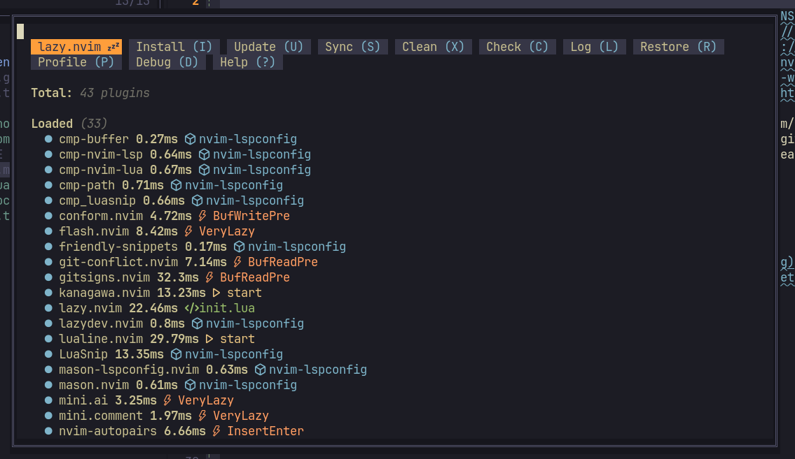
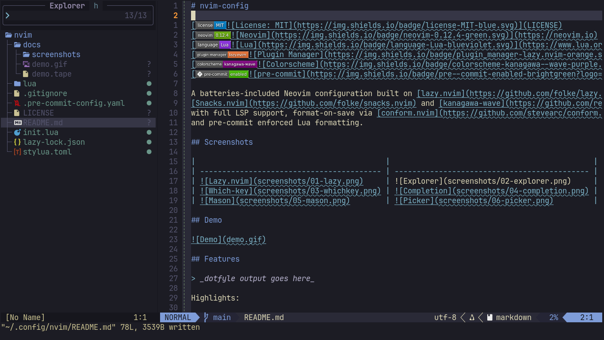
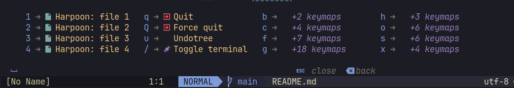
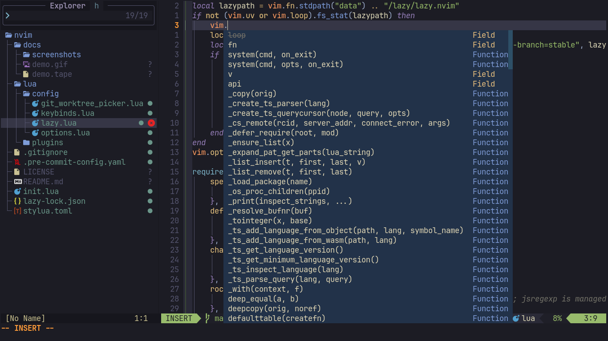
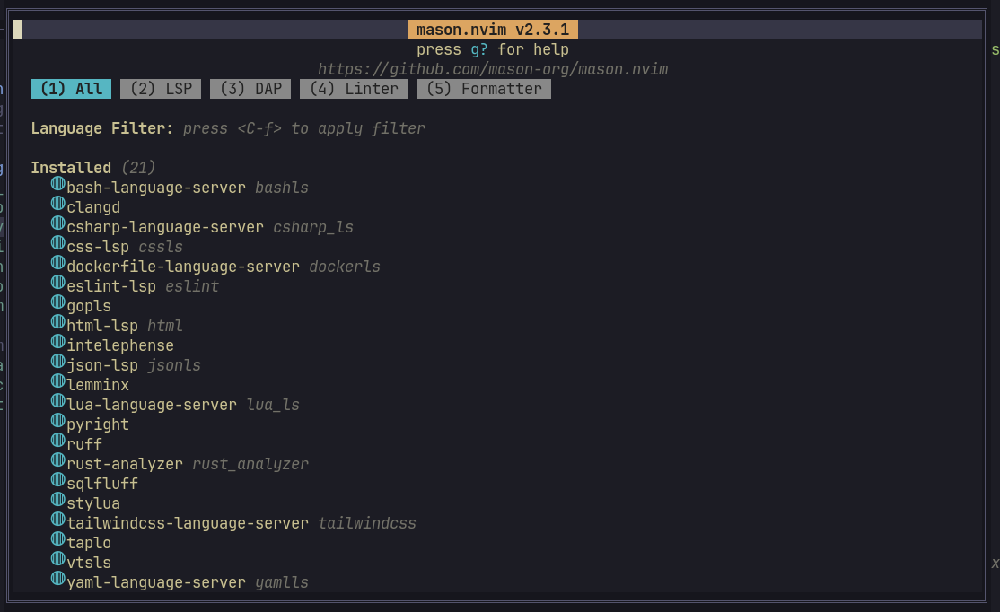
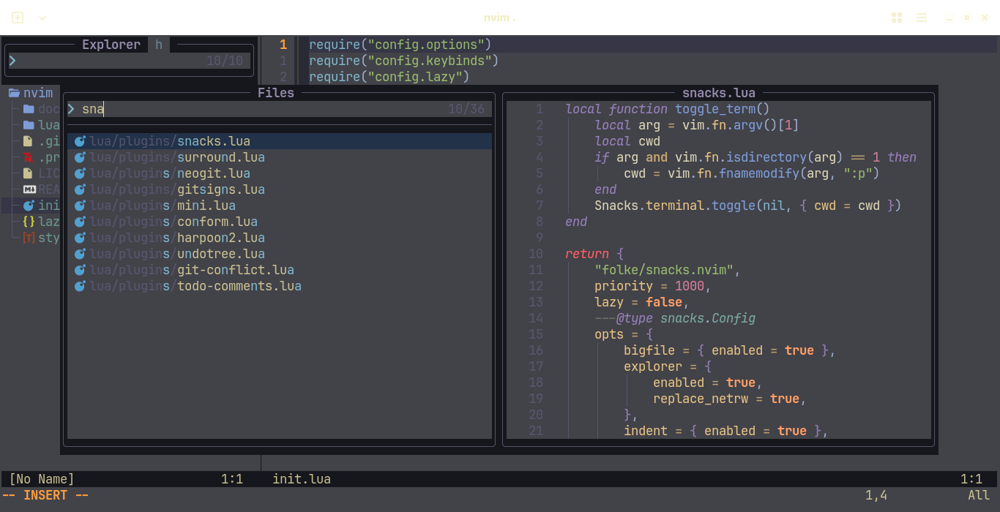

# nvim-config

[](https://neovim.io)
[](https://www.lua.org)
[](https://github.com/folke/lazy.nvim)
[](https://github.com/rebelot/kanagawa.nvim)

A batteries-included Neovim configuration built on [lazy.nvim](https://github.com/folke/lazy.nvim),
[Snacks.nvim](https://github.com/folke/snacks.nvim) and [kanagawa-wave](https://github.com/rebelot/kanagawa.nvim),
with full LSP support and format-on-save via [conform.nvim](https://github.com/stevearc/conform.nvim).

## Screenshots

|                                                |                                                   |
| ---------------------------------------------- | ------------------------------------------------- |
|      |      |
|  |  |
|         |          |

## Demo


## Features

<a href="https://dotfyle.com/izayoilv/nvim-config"></a>
<a href="https://dotfyle.com/izayoilv/nvim-config"></a>
<a href="https://dotfyle.com/izayoilv/nvim-config"></a>

## Plugins

### color

- [brenoprata10/nvim-highlight-colors](https://dotfyle.com/plugins/brenoprata10/nvim-highlight-colors)

### colorscheme

- [rebelot/kanagawa.nvim](https://dotfyle.com/plugins/rebelot/kanagawa.nvim)

### comment

- [folke/todo-comments.nvim](https://dotfyle.com/plugins/folke/todo-comments.nvim)
- [echasnovski/mini.comment](https://dotfyle.com/plugins/echasnovski/mini.comment)
- [folke/ts-comments.nvim](https://dotfyle.com/plugins/folke/ts-comments.nvim)

### completion

- [hrsh7th/nvim-cmp](https://dotfyle.com/plugins/hrsh7th/nvim-cmp)

### diagnostics

- [folke/trouble.nvim](https://dotfyle.com/plugins/folke/trouble.nvim)

### editing-support

- [windwp/nvim-ts-autotag](https://dotfyle.com/plugins/windwp/nvim-ts-autotag)
- [windwp/nvim-autopairs](https://dotfyle.com/plugins/windwp/nvim-autopairs)
- [echasnovski/mini.ai](https://dotfyle.com/plugins/echasnovski/mini.ai)
- [folke/snacks.nvim](https://dotfyle.com/plugins/folke/snacks.nvim)

### file-explorer

- [stevearc/oil.nvim](https://dotfyle.com/plugins/stevearc/oil.nvim)

### formatting

- [stevearc/conform.nvim](https://dotfyle.com/plugins/stevearc/conform.nvim)

### git

- [lewis6991/gitsigns.nvim](https://dotfyle.com/plugins/lewis6991/gitsigns.nvim)
- [sindrets/diffview.nvim](https://dotfyle.com/plugins/sindrets/diffview.nvim)
- [akinsho/git-conflict.nvim](https://dotfyle.com/plugins/akinsho/git-conflict.nvim)
- [NeogitOrg/neogit](https://dotfyle.com/plugins/NeogitOrg/neogit)

### github

- [pwntester/octo.nvim](https://dotfyle.com/plugins/pwntester/octo.nvim)

### icon

- [nvim-tree/nvim-web-devicons](https://dotfyle.com/plugins/nvim-tree/nvim-web-devicons)

### keybinding

- [folke/which-key.nvim](https://dotfyle.com/plugins/folke/which-key.nvim)

### lsp

- [neovim/nvim-lspconfig](https://dotfyle.com/plugins/neovim/nvim-lspconfig)

### lsp-installer

- [williamboman/mason.nvim](https://dotfyle.com/plugins/williamboman/mason.nvim)
- [williamboman/mason-lspconfig.nvim](https://dotfyle.com/plugins/williamboman/mason-lspconfig.nvim)
- [WhoIsSethDaniel/mason-tool-installer.nvim](https://dotfyle.com/plugins/WhoIsSethDaniel/mason-tool-installer.nvim)

### marks

- [ThePrimeagen/harpoon](https://dotfyle.com/plugins/ThePrimeagen/harpoon)

### motion

- [folke/flash.nvim](https://dotfyle.com/plugins/folke/flash.nvim)

### nvim-dev

- [nvim-lua/plenary.nvim](https://dotfyle.com/plugins/nvim-lua/plenary.nvim)
- [folke/lazydev.nvim](https://dotfyle.com/plugins/folke/lazydev.nvim)

### plugin-manager

- [folke/lazy.nvim](https://dotfyle.com/plugins/folke/lazy.nvim)

### search

- [MagicDuck/grug-far.nvim](https://dotfyle.com/plugins/MagicDuck/grug-far.nvim)

### snippet

- [L3MON4D3/LuaSnip](https://dotfyle.com/plugins/L3MON4D3/LuaSnip)
- [rafamadriz/friendly-snippets](https://dotfyle.com/plugins/rafamadriz/friendly-snippets)

### split-and-window

- [echasnovski/mini.bufremove](https://dotfyle.com/plugins/echasnovski/mini.bufremove)
- [mrjones2014/smart-splits.nvim](https://dotfyle.com/plugins/mrjones2014/smart-splits.nvim)

### statusline

- [nvim-lualine/lualine.nvim](https://dotfyle.com/plugins/nvim-lualine/lualine.nvim)

### syntax

- [nvim-treesitter/nvim-treesitter](https://dotfyle.com/plugins/nvim-treesitter/nvim-treesitter)
- [kylechui/nvim-surround](https://dotfyle.com/plugins/kylechui/nvim-surround)

## Language Servers

- bashls
- clangd
- csharp_ls
- cssls
- dockerls
- eslint
- gopls
- html
- intelephense
- jsonls
- lemminx
- lua_ls
- pyright
- ruff
- rust_analyzer
- tailwindcss
- taplo
- vtsls
- yamlls

> `sqlfluff`, `stylua`, and `ktlint` are installed via Mason, and `ruff` formats with `ruff_format`.
> These lists were generated from [Dotfyle](https://dotfyle.com) for `izayoilv/nvim-config`.

## Extras

- **Format-on-save** — conform.nvim (stylua, prettier, ruff_format, gofmt, rustfmt, clang-format,
  ktlint, with LSP fallback). `<leader>fo` formats manually
- **Snacks.nvim** — picker (finder/live grep/buffers/help), explorer sidebar with git-status badges
  (hidden files shown by default, `<a-h>` toggles hidden, `<a-i>` toggles ignored), terminal,
  notifications, image support
- **Git** — gitsigns, neogit, diffview, grug-far, git-worktree, git-conflict

## Keybindings

Leader key is `<space>` (which-key shows every mapping).

| Mapping            | Action                        |
| ------------------ | ----------------------------- |
| `<space>cd`        | Explorer sidebar toggle       |
| `<space>cf`        | Explorer: reveal current file |
| `<space>ff`        | Find files                    |
| `<space>fg`        | Live grep                     |
| `<space>fb`        | Buffers                       |
| `<space>fh`        | Help tags                     |
| `<space>/`         | Toggle terminal               |
| `<leader>fo`       | Format file                   |
| `:Lazy` / `:Mason` | Plugin / LSP managers         |

## Requirements

- Neovim 0.12+
- Git
- Optional providers: node/pnpm (`neovim` npm package), `perl Neovim::Ext`, ruby `neovim` gem
- jsregexp is managed outside lazy.nvim via hererocks (`lua-rocks`) for LuaSnip transformations

## Installation

```sh
git clone https://github.com/izayoilv/dotfiles.git ~/.dotfiles
cd ~/.dotfiles
./install.sh
nvim --headless "+Lazy! sync" +qa
nvim --headless "+MasonToolsInstallSync" +qa
```
